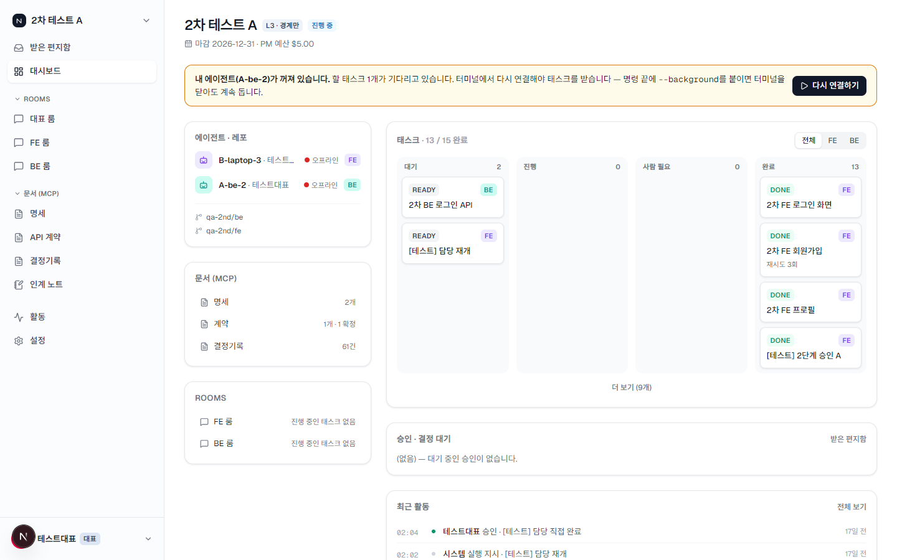
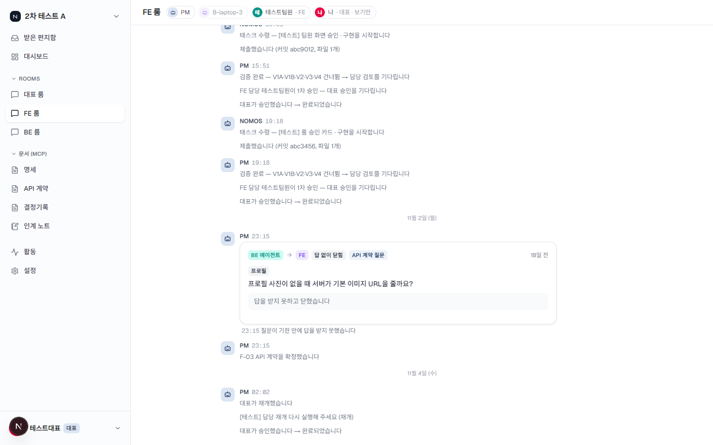
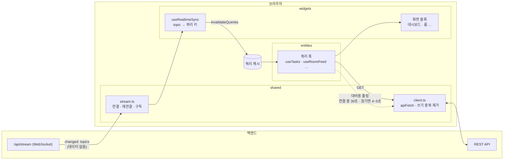

# NOMOS frontend

AI 에이전트 팀이 일하는 것을 사람이 지켜보고, 승인하고, 질문에 답하는 협업 도구의 웹 프론트엔드.
에이전트가 태스크를 받아 구현하면 서버가 검증하고, 사람은 대시보드와 룸에서 진행 상황을 실시간으로 보며 필요한 순간에만 개입한다.

백엔드는 별도 레포다 ([Capstone-NOMOS/backend](https://github.com/Capstone-NOMOS/backend) · Node · TypeScript · PostgreSQL).

| 대시보드 | 역할 룸 |
| --- | --- |
|  |  |

스크린샷은 로컬 테스트 데이터다.

## 스택

`src`에서 실제로 import하는 것만 적는다.

| 영역 | 사용 |
| --- | --- |
| 프레임워크 | Next.js 16 (App Router · Turbopack) · React 19 · TypeScript |
| 서버 상태 | `@tanstack/react-query` |
| 실시간 | 브라우저 기본 `WebSocket` (라이브러리 없음) |
| 스타일 | Tailwind CSS v4 · `lucide-react` 아이콘 |
| API 타입 | `openapi-typescript`로 백엔드 OpenAPI에서 생성 |
| 품질 | ESLint + `eslint-plugin-boundaries` · Prettier · Vitest · GitHub Actions |
| 배포 | Vercel |

전역 상태 라이브러리, UI 컴포넌트 라이브러리, 마크다운 라이브러리는 쓰지 않는다. 화면의 데이터는 전부 서버에서 오고 쿼리 캐시가 유일한 보관소다.

## 아키텍처

서버는 화면에 **데이터를 밀어 주지 않는다.** "무엇이 바뀌었는지"만 알려 주고, 화면은 그 신호로 해당 쿼리를 다시 읽는다.



- **신호 경로(실선)** — 서버에서 변화가 커밋되면 `/api/stream`으로 topic이 온다. `useRealtimeSync`가 topic을 쿼리 키로 바꿔 무효화하고, 화면에 떠 있는 쿼리만 다시 읽는다
- **대비용 폴링(점선)** — 신호는 재전송되지 않는다. 연결이 끊긴 동안과, 이벤트를 남기지 않는 변화를 위해 폴링을 남겼다. 연결 중에는 30초, 끊기면 원래 주기로 돌아간다
- **레이어** — `app → widgets → entities → shared` 한 방향으로만 import한다. 문서가 아니라 린트(`eslint-plugin-boundaries`)가 판정한다

```
src/
  app/        라우팅 · 레이아웃 · 프로바이더. page.tsx는 위젯을 부르는 얇은 셸
  widgets/    화면 블록 (대시보드, 룸, 받은 편지함 …)
  entities/   도메인별 API 훅 · 쿼리 키 · 도메인 UI (task, room, question …)
  shared/     도메인을 모르는 부품 — fetch 래퍼, 실시간 연결, 포맷 유틸, 기본 UI
```

자세한 내용은 [docs/architecture.md](./docs/architecture.md).

## 설계 결정

결정은 전부 [docs/adr/](./docs/adr/)에 한 장씩 남겼다 (20개). 그중 이 레포의 모양을 정한 세 가지.

### 1. 서버는 데이터가 아니라 신호만 보낸다 ([ADR 0009](./docs/adr/0009-실시간-신호로-무효화.md))

**문제** — 에이전트가 일하는 동안 대시보드 · 룸 · 승인 카드가 새로고침 없이 바뀌어야 한다.

**선택지**

- 웹소켓으로 바뀐 데이터를 받아 캐시에 직접 써넣는다 — 가장 빠르지만, 같은 데이터를 만드는 경로가 둘(조회 응답 · 이벤트 payload)이 된다. 둘이 어긋나면 화면이 틀린다
- 웹소켓으로 "무엇을 다시 읽을지"만 받고, 데이터는 기존 조회 API로 다시 읽는다

**결정** — 두 번째. 신호가 오면 `invalidateQueries`로 해당 쿼리를 다시 읽는다. topic → 쿼리 키 매핑은 `useRealtimeSync.ts` 한 파일에 모았다.

**치른 비용**

- 신호마다 조회 요청이 한 번 더 나간다. 반영까지 약 0.1~0.7초
- 신호는 재전송되지 않아서, 재연결할 때마다 열린 화면 전체를 다시 읽어야 한다
- 웹소켓 메시지는 OpenAPI로 표현되지 않아 생성 타입이 없다

**얻은 것** — 데이터의 출처가 조회 API 하나다. 권한 · 직렬화 · 타입이 한 곳에서만 정해진다. 그리고 쿼리 훅은 실시간이 있는지 모른다 — 폴링만 쓰던 훅을 그대로 두고 실시간을 붙였다.

### 2. 실시간을 붙이고도 폴링을 지우지 않았다 ([ADR 0004](./docs/adr/0004-당분간-폴링.md) → [0009](./docs/adr/0009-실시간-신호로-무효화.md) → [0020](./docs/adr/0020-신호-연결-중-재요청-제거.md))

**문제** — 처음에는 백엔드에 실시간 채널이 없었다. 그렇다고 화면을 멈춰 둘 수는 없었다.

**선택지**

- 실시간 채널이 생길 때까지 기다린다
- 실시간 라이브러리(Socket.IO 등)를 먼저 넣고 서버를 맞춘다 — 프로토콜은 백엔드와 함께 정할 계약인데 프론트가 먼저 정하게 된다
- 폴링으로 시작하되, 나중에 갈아 끼울 수 있게 모든 조회를 쿼리 훅 뒤에 둔다

**결정** — 세 번째. 그리고 웹소켓이 생긴 뒤에도 폴링을 지우지 않고 **주기만 바꿨다** (`livePoll`: 연결 중 30초, 끊기면 4~5초). 연결이 끊긴 사이의 변화와, 이벤트를 남기지 않아 신호가 없는 변화를 폴링이 메운다.

**치른 비용**

- 아무 일이 없어도 30초마다 요청이 나간다
- "신호가 오는 쿼리"와 "신호가 없어 폴링에 기대는 쿼리"를 사람이 구분해 관리해야 한다

**이어진 결정** — 신호가 연결돼 있으면 "신호가 없었다 = 바뀌지 않았다"가 성립한다. 그래서 연결 중에는 받은 데이터를 30초간 최신으로 본다 (ADR 0020). 화면을 오갈 때의 재요청이 사라졌다.

### 3. 승인 · 질의는 낙관적 업데이트를 하지 않고, 쓰기 요청은 한 번만 보낸다 ([architecture.md §6 · §10](./docs/architecture.md), [`client.ts`](./src/shared/api/client.ts))

**문제** — 사람이 누르는 승인 · 반려 · 답변은 에이전트의 다음 행동을 정하고 결정 기록으로 남는다. 화면이 "승인됨"을 먼저 보여 줬는데 서버가 거절하면(권한 없음, 이미 닫힌 질문), 사람은 틀린 상태를 보고 다음 판단을 한다. 같은 요청이 두 번 가면 기록이 두 줄 남는다.

**선택지**

- 낙관적 업데이트 — 누르는 즉시 화면을 바꾸고, 실패하면 되돌린다. 빠르게 느껴진다
- 서버 응답을 기다렸다가 바꾼다

**결정** — 판정 주체는 서버다. 응답이 오기 전에는 화면 상태를 바꾸지 않는다. 요청 중에는 버튼을 막고, 같은 쓰기 요청(메서드 · 경로 · 본문)이 겹치면 `apiFetch`가 하나만 보내고 결과를 나눠 갖는다.

**치른 비용**

- 누른 뒤 응답이 올 때까지 화면이 그대로다. 그 사이를 버튼 비활성화로만 알린다
- `disabled={isPending}`은 다음 렌더에야 걸려서 더블클릭의 두 번째 클릭을 못 막는다. 그래서 fetch 래퍼에 중복 제거를 따로 넣어야 했다

이 규칙은 정적 검사로 표현하기 어려워 린트로 막지 못했다. `AGENTS.md`의 규칙과 `client.test.ts`("같은 쓰기 요청 동시 2회 → fetch 1회")로 지킨다.

## 성능

두 가지를 재고 고쳤다. 수치는 한 기기(i7-1165G7 · 16GB · Chrome 157)에서 잰 값이다 — 절대값보다 전후 비율을 볼 것.

### 화면을 오갈 때의 재요청 ([ADR 0020](./docs/adr/0020-신호-연결-중-재요청-제거.md))

대시보드 → 활동 → 대시보드를 3번 왕복하며 `/api` 요청 수를 셌다 (로컬 백엔드 · 개발 모드 · 신호 연결 상태 · Resource Timing).

| | 활동으로 이동 | 대시보드로 복귀 | 왕복 3회 합계 |
| --- | --- | --- | --- |
| 이전 (`staleTime: 0`) | 3건 | 10건 | 39건 |
| 이후 (30초 안) | 0건 | 0건 | 0건 |

30초가 지난 뒤 돌아오면 이전처럼 다시 읽는다.

### 룸 피드 렌더 ([docs/perf-room-feed.md](./docs/perf-room-feed.md))

더미 피드 500 · 2,000줄, 프로덕션 프로파일링 빌드(`next build --profile`), React `<Profiler>`의 커밋 시간. 예열 3회를 버리고 5회의 중앙값.

| 상황 | 줄 수 | 변경 전 | 변경 후 |
| --- | --- | --- | --- |
| "생각 중" 타이머 1틱 (에이전트 실행 중 매초) | 500 | 138.4ms | 0.1ms |
| | 2,000 | 619.7ms | 0.4ms |
| 새 줄 1개 도착 | 500 | 167.3ms | 3.4ms |
| | 2,000 | 668.0ms | 9.9ms |
| 처음 그리기 (룸 재진입) | 500 | 246.9ms | 225.1ms |
| | 2,000 | 1314.7ms | 1015.2ms |

- **고친 것** — 1초 타이머가 피드 전체를 다시 그리던 것(타이머 state를 작은 컴포넌트로), 새 줄 하나에 모든 줄이 다시 그려지던 것(줄 `memo` + id 기준 구조 공유)
- **재 보니 병목이 아니었던 것** — 줄 계산(`toRows`). 2,000줄에 0.03ms라 `useMemo`를 넣지 않았다
- **고치지 않은 것** — 처음 그리기. 줄이려면 목록 가상화가 필요한데, 질문 카드에 쓰던 답이 사라지는 문제 등과 충돌한다. 룸은 처음에 50줄만 받으므로 지금은 하지 않기로 했다
- 커밋 시간은 렌더 시간이다. 레이아웃 · 페인트는 들어 있지 않다. 더미의 줄 구성 비율은 가정이다

측정 도구(목 서버 · 수집 스크립트)와 원본 값은 [`perf/`](./perf/)에 있다.

## 테스트

```bash
pnpm test
```

화면은 로컬 백엔드에 붙여 브라우저로 확인한다. 테스트는 **화면으로는 확인하기 어렵고, 틀리면 조용히 망가지는** 로직에만 썼다 (59개 · [ADR 0019](./docs/adr/0019-미사용-의존성-제거와-테스트-도입.md)).

| 대상 | 무엇을 | 왜 |
| --- | --- | --- |
| `shared/api/stream.ts` | 토큰은 URL이 아닌 첫 메시지로 · 재구독 · 1초 → 최대 30초 백오프 · 재연결하지 않는 닫힘 코드 · resync | 끊김과 재연결은 손으로 재현하기 어렵다. 틀리면 "가끔 화면이 안 바뀐다"로만 나타난다 |
| `widgets/auth/useRealtimeSync.ts` | 신호가 어떤 쿼리를 다시 읽게 하는가 | 매핑에서 빠진 쿼리는 에러 없이 낡은 채로 남는다 |
| `shared/api/client.ts` | 같은 쓰기 요청 동시 2회 → fetch 1회 · 401 처리 | 중복 제출은 결정 기록을 오염시킨다 |
| `widgets/auth/safeNext.ts` | `//evil` · `/\evil` 거부 | 로그인 뒤 돌아갈 경로의 열린 리다이렉트 |
| `entities/room/api/roomApi.ts` | id 기준 구조 공유 — 바뀐 줄만 새 객체 | 성능 개선의 전제. 틀리면 바뀐 줄이 화면에 반영되지 않는다 |
| `widgets/room/feedRows.ts` | 질문 줄 묶기 · 역할별 거르기 | 측정하며 옮긴 함수의 동작 고정 |

jsdom · 컴포넌트 렌더 테스트 · E2E · 커버리지 목표는 두지 않았다. 브라우저 API(`WebSocket` · `fetch`)는 테스트가 직접 스텁한다.

CI는 PR마다 `format:check → lint → typecheck → test → build`를 돌린다.

## AI 활용 방식

이 레포의 코드는 대부분 Claude Code와 함께 썼다. 숨기지 않는다 — 머지 커밋을 뺀 81개 커밋 중 80개에 `Co-Authored-By: Claude` 트레일러가 있다.

역할은 이렇게 나눴다.

| | 누가 |
| --- | --- |
| 무엇을 만들지 — 기능 명세, 백엔드와의 API 계약 | 사람 |
| 어떻게 만들지의 결정 — ADR 20개. 선택지와 치를 비용을 보고 고른다 | 사람 |
| 구현 · 리팩터링 · 테스트 작성 · 측정 스크립트 실행 · 문서 초안 | Claude Code |
| 검증 — 무엇을 어떤 기준으로 잴지 정하기, 결과 판단, 화면 확인, PR 리뷰와 머지 | 사람 |

AI가 규칙을 "기억"하기를 기대하지 않고, 어길 수 없게 고정했다.

- **[`AGENTS.md`](./AGENTS.md)** — 매 세션에 읽히는 규칙. "명세와 코드가 다르면 명세가 맞다", "명세에 없는 결정은 지어내지 말고 질문할 것", "패키지 추가 전 반드시 물어볼 것", 낙관적 업데이트 금지 등
- **경계 린트** — 레이어 규칙은 문서가 아니라 `eslint-plugin-boundaries`가 판정한다. 예외를 추가해 우회하는 것은 금지다 ([ADR 0006](./docs/adr/0006-규칙을-기계로-고정.md))
- **CI 게이트** — 포맷 · 린트 · 타입 · 테스트 · 빌드를 통과해야 머지된다
- **ADR** — 한 번 내린 결정을 다음 세션이 뒤집지 않게 한다. "왜 이렇게 돼 있지?"의 답이 코드 옆에 있다
- **흐름** — 이슈 → 브랜치 → 작업 → PR. 머지는 사람이 한다

잘 안 됐던 것도 있다. 성능 측정에서 처음 세운 가설("줄 계산이 병목일 것")은 재 보니 틀렸고, 개발 모드 수치는 예열에 따라 몇 배씩 달라져 프로덕션 빌드로 다시 재야 했다. 측정 과정은 [docs/log.md](./docs/log.md)에 그대로 남겼다.

## 실행

Node 20.9 이상 · pnpm 10 이상.

```bash
pnpm install
pnpm dev          # http://localhost:3001
```

백엔드 주소는 `.env.local`의 `NEXT_PUBLIC_API_BASE_URL`로 준다 (예: `http://localhost:3000/api`).

```bash
pnpm format       # Prettier
pnpm lint         # ESLint + 레이어 경계
pnpm typecheck    # next typegen + tsc
pnpm test         # Vitest
pnpm build
pnpm gen:api      # 백엔드 OpenAPI에서 타입 재생성
```

## 문서

[docs/README.md](./docs/README.md)에 목록이 있다 — 기능 명세, 아키텍처, 컨벤션, 디자인 토큰, ADR.
